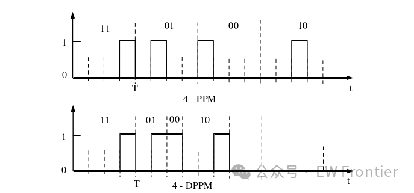
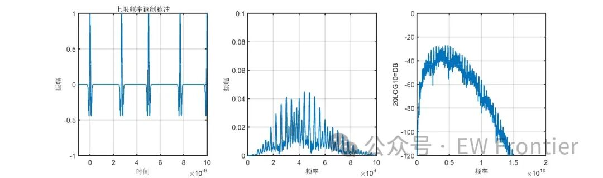
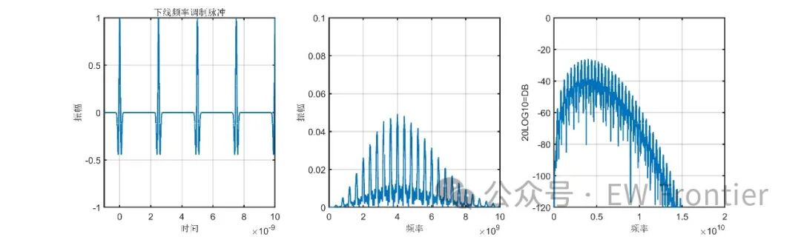
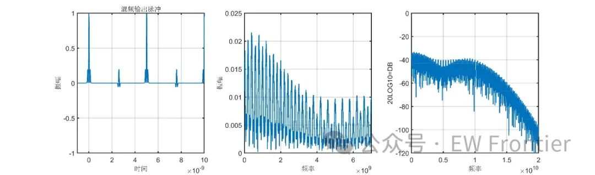
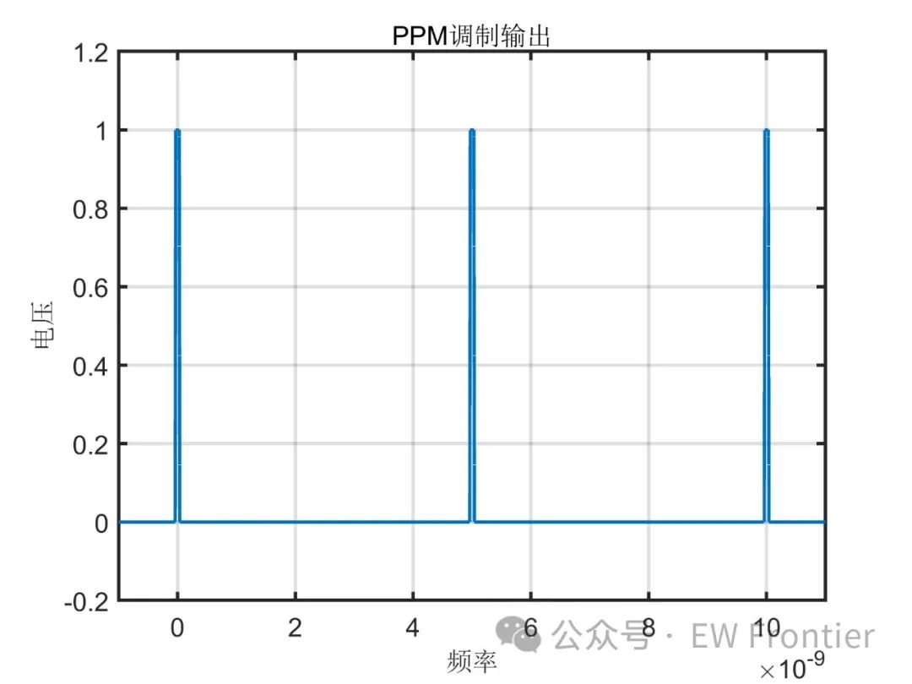

# Optical Communication Technology: Pulse Position Modulation (PPM) [With MATLAB Code]

Single-Pulse Position Modulation (L-PPM)
Differential Pulse Position Modulation (L-DPPM)
Multi-Pulse Position Modulation (Mulit-PPM)
MATLAB Code for PPM:
PPM Basic Concepts:
Pulse Position Modulation (PPM) is a technique that generates pulse signals by encoding, and then modulates the baseband signal. This means that the information of the signal is appended to the PPM pulse signals, with the modulating signal determining the time of the carrier pulse. Specifically, it involves a n-bit binary information being encoded into a specific position in a certain slot, then sending this binary information in that determined slot, while the receiver detects and synchronizes the clock based on these positional information to demodulate the transmitted signal. Based on the different forms of pulses, PPM can be divided into Single-Pulse Position Modulation (L-PPM), Differential Pulse Position Modulation (L-DPPM), and Multi-Pulse Position Modulation (Mulit-PPM).
Single-Pulse Position Modulation (L-PPM):
L-PPM is a modulation technique that transmits a n-bit binary data within a period, if we divide this period into 2n slots, then each slot's pulse signal corresponds to the value in the n-bit binary number and the corresponding relationship between the slot pulse and the value in L-PPM is as follows:
Where m represents a value in the n-bit binary number, L represents the position of the n-bit binary number in the L-PPM period.
Differential Pulse Position Modulation (L-DPPM):
Unlike L-PPM, L-DPPM has an unfixed length within a period. If we remove the high-level slots after the high-level pulse in L-PPM, we get L-DPPM where all the end slots are high-level, as shown in the following diagram.
Figure 1: Signal Form of L-PPM and L-DPPM
Multi-pulse position modulation (MPPM) is based on the principle that a 2n-bit binary array is mapped onto pulses within a time slot during one cycle. Compared to L-PPM, which can only have a single pulse per time slot, MPPM allows for multiple pulses within a cycle. The implementation of MPPM is complex and challenging, making it rarely used in visible light communication systems.
PPM MATLABCode: clcclear allclose all\npw1=.5e-9;%Pulse width\npw=pw1/2.5;% Fujii factors\nFs=100e9;% Sampling frequency\nFn=Fs/2;% Nyquist frequency\nt=-1e-9:1/Fs:20e-9;% Sampling time\nA=1;\ny =A*(1 - 4*pi.*((t)/pw).^2).* exp(-2*pi.*((t)/pw).^2);%Gaussian single\nyp=y+ ...\nA*(1-4*pi.*((t-2.5e-9-.2e-9)/pw).^2).*exp(-2*pi.*((t-2.5e-9-.2e-9)/pw).^2)+ ...\nA*(1-4*pi.*((t-5.0e-9)/pw).^2).*exp(-2*pi.*((t-5.0e-9)/pw).^2)+ ...\nA*(1-4*pi.*((t-7.5e-9-.2e-9)/pw).^2).*exp(-2*pi.*((t-7.5e-9-.2e-9)/pw).^2)+ ...\nA*(1-4*pi.*((t-10e-9)/pw).^2).*exp(-2*pi.*((t-10e-9)/pw).^2);\n%PPM modulation upper limit\n\nB=1;\nyum=B*y+ ...\nB*(1-4*pi.*((t-2.5e-9)/pw).^2).*exp(-2*pi.*((t-2.5e-9)/pw).^2)+ ...\nB*(1-4*pi.*((t-5.0e-9)/pw).^2).*exp(-2*pi.*((t-5.0e-9)/pw).^2)+ ...\nB*(1-4*pi.*((t-7.5e-9)/pw).^2).*exp(-2*pi.*((t-7.5e-9)/pw).^2)+ ...\nB*(1-4*pi.*((t-10e-9)/pw).^2).*exp(-2*pi.*((t-10e-9)/pw).^2);\nyc=yp.*yum;%Output Frequency = Mixed output of PPM modulation upper and lower limits\n\ny=yp;%y=upper frequency\nNFFY=2.^(ceil(log(length(y))/log(2)));\nFFTY=fft(y,NFFY);\nNumUniquePts=ceil((NFFY+1)/2); \nFFTY=FFTY(1:NumUniquePts);\nMY=abs(FFTY);\nMY=MY*2;\nMY(1)=MY(1)/2;\nMY(length(MY))=MY(length(MY))/2;\nMY=MY/length(y);\nf=(0:NumUniquePts-1)*2*Fn/NFFY;\n\ny1=yum;% Adjustment of the lower limit\nNFFY1=2.^(ceil(log(length(y1))/log(2)));\nFFTY1=fft(y1,NFFY1);\nNumUniquePts=ceil((NFFY1+1)/2); \nFFTY1=FFTY1(1:NumUniquePts);\nMY1=abs(FFTY1);\nMY1=MY1*2;\nMY1(1)=MY1(1)/2;\nMY1(length(MY1))=MY1(length(MY1))/2;\nMY1=MY1/length(y1);\nf=(0:NumUniquePts-1)*2*Fn/NFFY1;\n\ny2=yc;\nNFFY2=2.^(ceil(log(length(y2))/log(2)));\nFFTY2=fft(y2,NFFY2);%pad with zeros\nNumUniquePts=ceil((NFFY2+1)/2); \nFFTY2=FFTY2(1:NumUniquePts);\nMY2=abs(FFTY2);\nMY2=MY2*2;\nMY2(1)=MY2(1)/2;\nMY2(length(MY2))=MY2(length(MY2))/2;\nMY2=MY2/length(y2);\nf=(0:NumUniquePts-1)*2*Fn/NFFY2;\n\nfigure(1)\nsubplot(1,3,1); plot(t,y);xlabel('Time');ylabel('Amplitude');\ntitle('Up-limit frequency modulated pulse');\ngrid on;\naxis([-1e-9,10e-9 -1 1])\nsubplot(1,3,2); plot(f,MY);xlabel('Frequency');ylabel('Amplitude');\naxis([0 10e9 0 .1]);%zoom in/out\ngrid on;\nsubplot(1,3,3); plot(f,20*log10(MY));xlabel('Frequency');ylabel('20LOG10=DB');\naxis([0 20e9 -120 0]);\ngrid on;\n\nfigure(2)\nsubplot(1,3,1); plot(t,y1);xlabel('Time');ylabel('Amplitude');\ntitle('Downlink frequency modulated pulse');\ngrid on;\naxis([-1e-9,10e-9 -1 1])\nsubplot(1,3,2); plot(f,MY1);xlabel('Frequency');ylabel('Amplitude');\naxis([0 10e9 0 .1]);\ngrid on;\nsubplot(1,3,3); plot(f,20*log10(MY1));xlabel('Frequency');ylabel('20LOG10=DB');\naxis([0 20e9 -120 0]);\ngrid on;\n\nfigure(3)\nsubplot(1,3,1); plot(t,y2);xlabel('Time');ylabel('Amplitude');\ntitle('Mixed-frequency output pulses');\ngrid on;\naxis([-1e-9,10e-9 -1 1])\nsubplot(1,3,2); plot(f,MY2);xlabel('Frequency');ylabel('Amplitude');\naxis([0 7e9 0 .025]);%zoom in/out\ngrid on;\nsubplot(1,3,3); plot(f,20*log10(MY2));xlabel('Frequency');ylabel('20LOG10=DB');\naxis([0 20e9 -120 0]);\ngrid on;\n\npt=.5;%Drive voltage\nH=1;\nL=0;\nLEN=length(y2);\nfor ii=1:LEN;\n    if y2(ii)>=pt/2;\n        pv(ii)=H;\n    else;\n        pv(ii)=L;\n    end;\nend ;\npo=pv;\n\nfigure(4)\nplot(t,po);\naxis([-1e-9 11e-9 -0.2 1.2])\ntitle('    PPMModulation output');\nxlabel('Frequency');\nylabel('Voltage');\ngrid on;\nMATLABSimulation results: ​  

## Images

<!-- PAYMENT_BLOCK -->

## Get this dataset

- Payment link (Stripe): [Buy now](https://buy.stripe.com/3cs8yP7sY87d0vu9AB)
- Payment QR code: 

<!-- /PAYMENT_BLOCK -->
